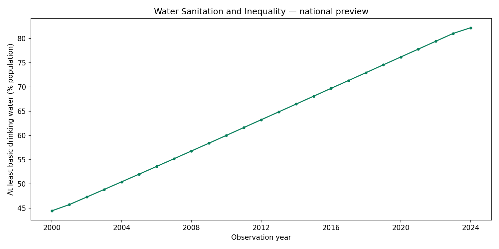

# Water Sanitation and Inequality

Scope: NATIONAL_PREVIEW_ONLY

National estimates cannot produce state or wealth-group inequalities. Survey extensions remain pending.

SQL change calculations were independently reconciled against pandas. See outputs/latest.csv for last observed values by metric; different indicators can end in different years. No cross-indicator total is meaningful. Missing values were not set to zero.

Primary case study and native BI dashboards remain incomplete.
