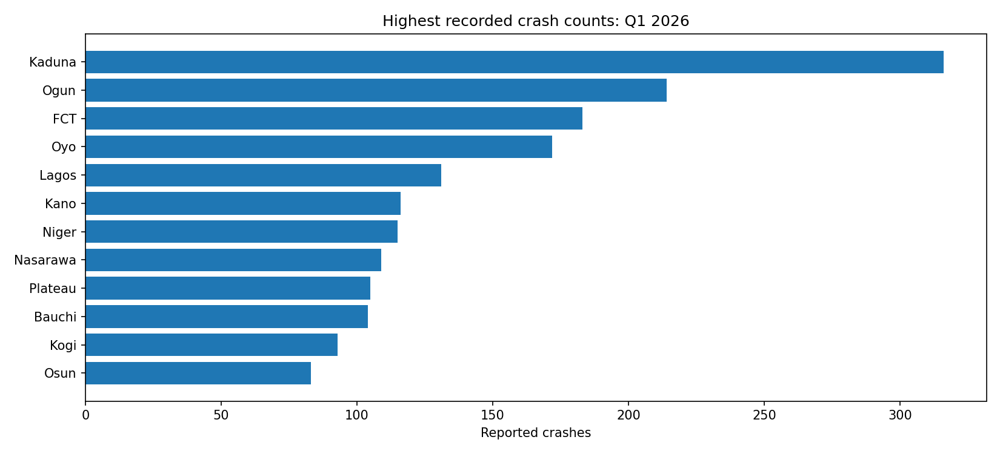

# Road Crashes across States: primary NBS analysis

Kaduna recorded the largest crash count in Q1 2026: 316. This is a count ranking, not a road-user risk ranking.

## Evidence and validation
22 quarters × 37 states/FCT = 814 state-quarter records. All eight state-count columns reconcile to source national totals in every quarter. Severity categories and casualty components reconcile for every state-quarter. The latest-quarter factor columns separately reconcile to published national totals. The adapter records source hashes and exact workbook rows.

## Methods
SQL is in sql/primary_analysis.sql. Source: https://microdata.nigerianstat.gov.ng/index.php/catalog/164/download/1405. Data tables and a balanced-period seasonality comparison are exported in outputs/.

## Limits
No mileage or journey exposure denominator is available. Reporting and traffic volumes differ across states.

## Decision use
Use counts to select locations or periods for a more detailed reporting and exposure audit. Do not equate fewer reports with safer roads.

Native Power BI and Tableau authoring/validation is deferred to the user’s desktop session.
